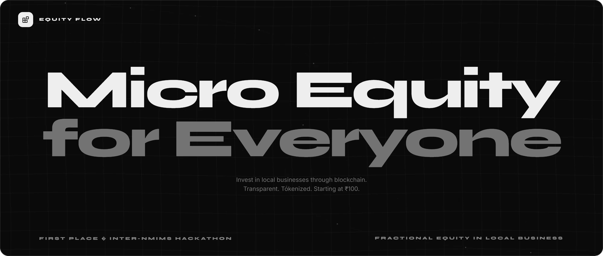
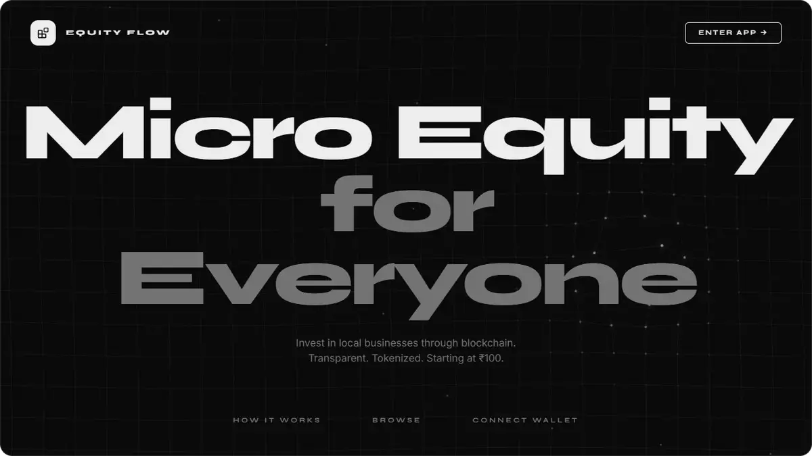
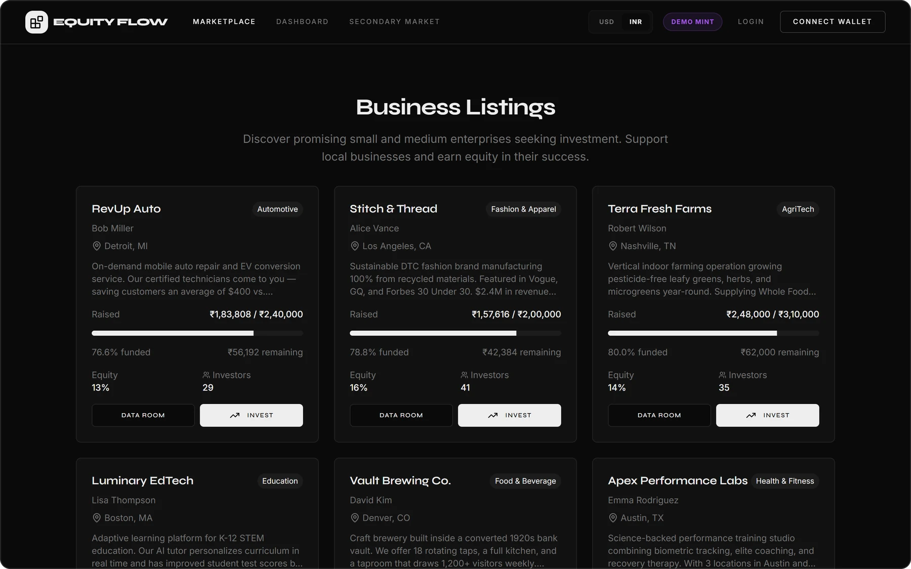
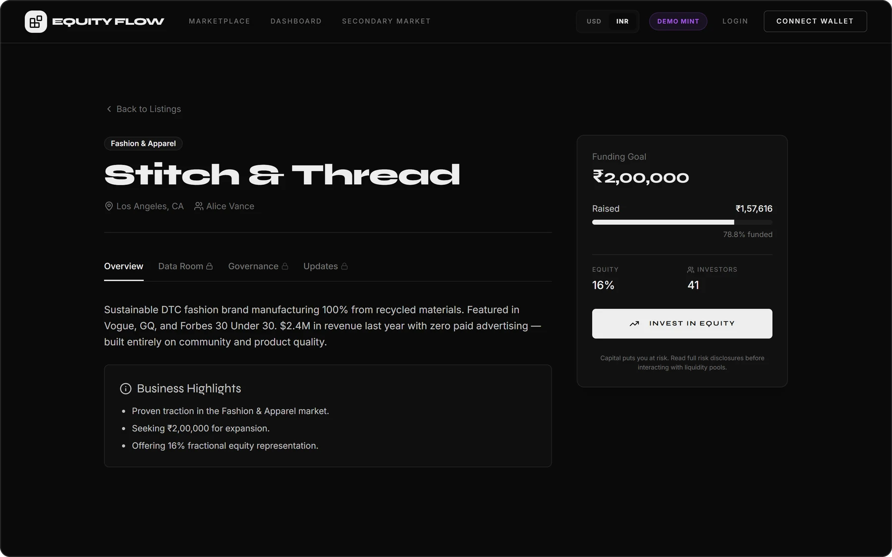
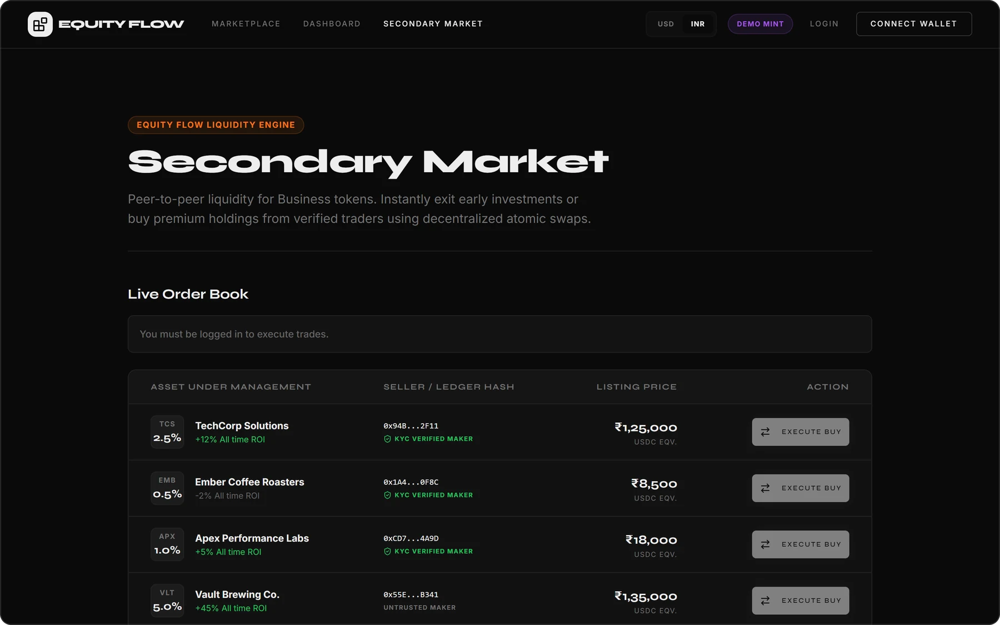

 

  <b>Equity Flow</b> lets anyone own a piece of the local businesses they believe in. 
  Small and medium enterprises raise capital by offering fractional equity, 
  and investors back them from ₹100, with every share tokenized and on the record.

  

  First place, Inter-NMIMS Hackathon

 

 
 

<h3 align="center">A marketplace for the businesses next door</h3>

  Businesses list what they are raising, the equity they offer and how far along they are. 
  Investors browse, compare and back them in a few taps.

 
 

<h3 align="center">Every listing, an open book</h3>

  Each business gets its own page: the goal, what has been raised, the equity on offer and who has backed it, 
  with a data room, shareholder votes and updates behind it.

 
 

<h3 align="center">A way out, not just a way in</h3>

  A secondary market lets investors sell their stake to other investors, 
  so backing a local business no longer means waiting years for an exit.

 
 

  
    
  React, TypeScript and Firebase.
   
  © 2026 Dhruv Sonar. All rights reserved.

